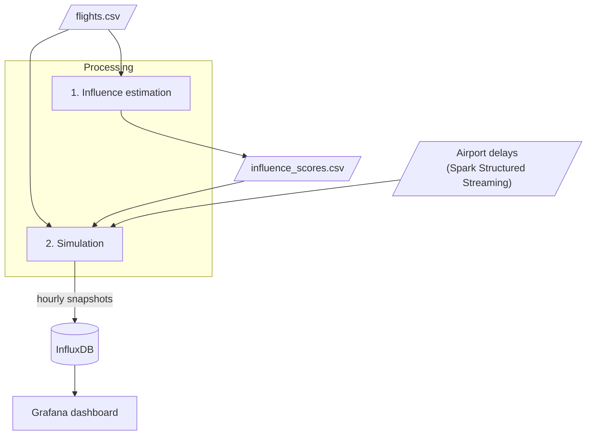

# Flight Delay Propagation

Flight delay propagation simulation built with Apache Spark, InfluxDB and Grafana, based on the [US DOT 2015 Flight Delays](https://www.kaggle.com/datasets/usdot/flight-delays) dataset.

## Project

The project simulates how delays propagate through the US airport network, following the approach of [*A Spatial–Temporal Network Perspective for the Propagation Dynamics of Air Traffic Delays*](#references), but changes how competing flights are prioritized: instead of looking only at each flight's accumulated delay, the decision also uses an **influence score** per airport, which estimates how far a delay at that airport spreads through the network. The scores are computed with a distributed contagion model inspired by [*Influence at Scale*](#references), and the simulation can be run with or without them to compare the results.

## Pipeline



The design assumes a single, central execution of the simulation (for example by an air-traffic authority) that can communicate the resulting decisions to airports in real time.

### 1. Influence scores

#### The delay propagation graph

The influence model runs on a directed graph where **nodes are airports** and **edges are the routes** `origin → destination` observed in the flight data. Each edge carries the probability that a delay on that route propagates.

Two ways of building the graph are implemented, both returning the same structure:

| Builder | Edge probability |
| --- | --- |
| `create_graph` | Share of the route's flights with a departure delay above 15 minutes |
| `create_graph_v2` | Share of the route's *aircraft chains* in which the delay grows on the next leg (see below) |

**`create_graph`.** For every route, `probability = delayed flights / total flights`, where a flight is delayed if `DEPARTURE_DELAY > 15` minutes.

**`create_graph_v2`.** It uses `TAIL_NUMBER` to follow each aircraft through its day, in chronological order (local times are converted to absolute time using each airport's time zone). Two consecutive legs form a pair when they chain (the aircraft lands at `Y` and its next flight departs from `Y`) and the gap between their scheduled departures is at most 6 hours. For a route `X → Y`, the probability is the fraction of its pairs where the next leg departs with a delay larger than the previous leg's: that is, how often the delay actually *grows* on the following leg.

#### Computing the influence

The influence of an airport is the expected size of the cascade it triggers, i.e. how many airports end up affected on average when a delay starts there. The estimate follows the **InfEst** algorithm of *Influence at Scale*.

For each airport, a large number of samples are run: starting from the airport, every newly delayed airport tries to delay each of its outgoing neighbours independently, succeeding with the probability of that edge. A sample stops when it dies out or after 3 epochs. The score of the airport is determined by how many samples reach a given number of infected airports.

#### Implementations

The same estimator is implemented four times, so that approaches and performance can be compared:

| Job | Approach |
| --- | --- |
| `influence_sequential` | Plain Python, non-distributed baseline |
| `influence_sample_parallel` | Parallelized over samples, with a local graph exploration per task |
| `influence_mapreduce` | MapReduce SampleOracle, one seed set at a time. Each sample is a set of `(sample_id, airport)` records labelled `NEW`/`OLD`; every epoch, `NEW` records infect neighbours (map) and records are merged per key (reduce) |
| `influence_mapreduce_batched` | MapReduce, all airports processed together at each InfEst level. This reduces the number of operations, but produces a much larger RDD, especially with a higher number of samples |

The output is a CSV with columns `airport,score`. A precomputed `dataset/influence_scores.csv` is included.

### 2. Simulation

The simulation advances minute by minute over one day of real flights, keeping the state of every flight in a Spark RDD (up to 2,880 minutes, so that overnight flights can finish). Delays from the historical data are kept for the first leg of each aircraft, and delays generated by the simulation are added on top. At each minute it applies the incoming airport delays, resolves departure and landing conflicts, and makes the next leg of each aircraft ready once the aircraft has landed and the turnaround time has elapsed. Every 60 simulated minutes it takes a snapshot of the network and writes the metrics to InfluxDB.

**Priority rule.** When several flights compete for departure or landing, the one with the highest priority wins. The priority combines the flight's accumulated delay with the influence score of the arrival airport; with `simulation.influence: false` it depends on the delay alone.

### 3. Airport delay streaming

Besides the delays already present in the data, the simulation receives airport-level disruptions while it runs, the kind of unplanned events a controller would have to react to in real time: bad weather, runway closures, air-traffic restrictions. Each one is an extra delay (in minutes) attached to an airport rather than to a specific flight. A generator writes random airport delays as CSV files, which Spark Structured Streaming reads as a stream and feeds into the simulation.

### 4. Metrics and dashboard

Snapshots are processed and loaded into InfluxDB, and visualized in a provisioned Grafana dashboard.

| Measurement | Meaning |
| --- | --- |
| `dp_mag1` | Flights delayed by 60+ minutes, per origin airport, last hour |
| `dp_mag2` | Total delay minutes, per origin airport, last hour |
| `dp_spe` | Propagation speed: total delay normalized by number of airports |
| `events` / `control` | Applied airport delays, conflicts and which flight was chosen |

At the end of a run, aggregate statistics (including the influence-weighted total delay) are saved to `output/sim_stats.txt`, and the outcome of every flight to `output/sim_flights.csv`.

## Assumptions

The model is a simplification of real operations. These are the assumptions it makes.

- Each airport behaves as a single resource: one departure and one landing per minute, with a fixed time separation between consecutive operations.
- The turnaround time is a constant 45 minutes for every aircraft.
- Flight duration is always the scheduled duration: no en-route or airborne delays.
- Airport delays from the stream are random and independent across airports, and their duration is uniformly distributed. Their frequency is configurable.
- Influence scores are fixed for the whole simulated day.
- The same data is used to build the influence graph and to run the simulation. In a real deployment, the graph would be built from past data and applied to new, unseen flights.

## Quick start

**Requirements:** Docker.

```bash
git clone https://github.com/<user>/flight-delay-propagation.git
cd flight-delay-propagation

# 1. Set up InfluxDB and Grafana
docker compose up -d

# 2. Run the simulation
docker compose --profile jobs run --rm simulation
```

Then open **Grafana at <http://localhost:3000>** (`admin` / `admin`) and watch the snapshots arrive.

***The first run downloads the dataset automatically. A precomputed `dataset/influence_scores.csv` is included.***

### Recompute the influence scores

```bash
docker compose --profile jobs run --rm training-sample-parallel
```

Other options: `training-sequential`, `training-mapreduce`, `training-mapreduce-batched`. The result is written to `output/influence_scores.csv`.
To use the new scores in the simulation, copy the result into the `dataset` folder, replacing the original file.

## Configuration

Everything lives in [`config/config.yaml`](config/config.yaml):

```yaml
simulation:
  day: 2
  month: 8
  year: 2015
  influence: true          # false = delay-only baseline
  influence_rate: 1        # weight of influence in the priority
  delay_streaming: true    # enable airport disruptions
  write_events: true       # write textual events to InfluxDB

influence:
  fixed_samples: true      # fixed sample count instead of the theoretical bound
  n_samples: 20

delay_streaming:
  interval_sec: 10         # seconds between generated delay files
  probability: 0.001       # per-airport chance of receiving a delay
  delay_range: [5, 30]     # extra delay range in minutes
```

Input and output paths (`input.flights`, `input.influence`, `output.*`) can be customized too.

## Repository layout

```
config/       configuration
dataset/      precomputed influence scores (flights.csv is downloaded here)
grafana/      dashboard and provisioning
init/         setup scripts (dataset download, InfluxDB token and datasource)
src/
  influence/    influence modules
  jobs/         the four training jobs and the simulation
  simulation/   simulation modules
  utils/        Spark, InfluxDB, I/O, logging
  benchmark/    training and simulation benchmarks
tests/        unit tests
```

## References

- *A Spatial–Temporal Network Perspective for the Propagation Dynamics of Air Traffic Delays*
- *Influence at Scale: Distributed Computation of Complex Contagion in Networks*
- Dataset: [2015 Flight Delays and Cancellations, US DOT (Kaggle)](https://www.kaggle.com/datasets/usdot/flight-delays)